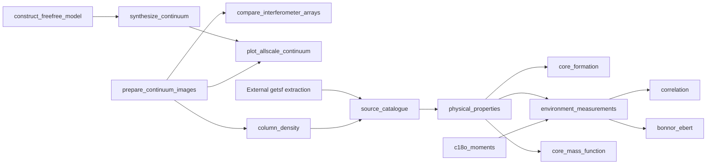

# LANCET notebook migration record

Final audit date: 2026-07-30

The active LANCET analysis has migrated from exploratory notebooks to tested
Python components, command-line scripts, configured tasks, and isolated
results. This document preserves the disposition of every former top-level
project notebook.

## Final scope

- 26 top-level project notebooks were reviewed.
- 26 files in the root `.ipynb_checkpoints/` directory were editor recovery
  copies and contained no independent workflow.
- Three Python autosaves in that checkpoint directory were byte-identical to
  their retained historical root scripts; only the duplicate autosaves were
  removed.
- Every retained scientific calculation is now represented by a Python
  script or configured task.
- Explicitly ignored or proposal-specific experiments were retired rather
  than incorporated into the reproducible workflow.
- Notebooks embedded in `data/delivered/archive/` and `data/reduction/` are
  external or reduction materials. They remain untouched and are not part of
  the active LANCET codebase.

## Notebook dispositions

| Former notebook | Final disposition |
|---|---|
| `0.0_random.ipynb` | Retired numerical scratch work |
| `0.1_ContinuumScience.ipynb` | Retired early continuum display sandbox; current displays use `plot_allscale_continuum` |
| `0.2_LineScience.ipynb` | Retired early line-display sandbox; current C18O products use `c18o_moments` |
| `0.3_CDStable_preparation.ipynb` | Retired one-off CDS table-preparation experiment |
| `0.4_Metallicity.ipynb` | Replaced by `scripts/gas_to_dust_ratio.py` |
| `0.5_Prepare4APEXproposal.ipynb` | Explicitly retired proposal-specific plotting; pre-existing scientific materials were preserved |
| `0.6_SourceDeconvolutionTest.ipynb` | Replaced by `lancet.deconvolve_gaussian` and `scripts/source_deconvolution.py` |
| `0.7_StarCluster.ipynb` | Replaced by `scripts/star_cluster.py` |
| `1.1_ConstructFFmodel.ipynb` | Replaced by `lancet.freefree` and the `construct_freefree_model` task |
| `1.2_SyntheticContinuum.ipynb` | Replaced by `lancet.continuum` and the `synthesize_continuum` task |
| `1.3_MultiArrayCombine.ipynb` | Split between the `prepare_continuum_images` and `compare_interferometer_arrays` tasks |
| `1.4_ShowInterSDcombine.ipynb` | Replaced by the `plot_allscale_continuum` task |
| `1.5_ConvertImageUnits.ipynb` | Replaced by `lancet.imaging` and the `prepare_continuum_images` task |
| `1.6_PrimaryBeamCorrection.ipynb` | Replaced by `lancet.imaging` and the `prepare_continuum_images` task |
| `2.1_ColumnDensity.ipynb` | Replaced by `lancet.column_density` and the `column_density` task |
| `2.2_GetsfResults.ipynb` | Catalogue construction and the `GetsfResult_FluxMeasure` and `GetsfResult_FluxRatio` diagnostics are reproduced by the `source_catalogue` task; unrelated test-field demonstrations were retired |
| `2.3_Background effects.ipynb` | Replaced by the `background_effects` supporting task |
| `2.4_PhysicsProperties.ipynb` | Replaced by `lancet.physical_properties` and the `physical_properties` task |
| `2.5_MakeBetterMoments.ipynb` | Replaced by the `c18o_moments` task |
| `3.1_CoreFormation.ipynb` | Replaced by `lancet.core_formation` and the `core_formation` task |
| `3.2_EnvMeasure.ipynb` | Replaced by `lancet.environment` and the `environment_measurements` task |
| `3.3_Correlation.ipynb` | Replaced by `lancet.correlation` and the `correlation` task |
| `3.4_BEsphere.ipynb` | Replaced by `lancet.stability` and the `bonnor_ebert` task |
| `3.5_CoreMassFunctions.ipynb` | Replaced by `lancet.core_mass_function` and the `core_mass_function` task |
| `X.1_MagneticFields.ipynb` | Replaced by the explicitly ongoing `magnetic_fields` task |
| `X.1_N-PDF.ipynb` | Replaced by the explicitly ongoing `n_pdf` task |

## Current dependency flow

The `background_effects` task is an independent supporting calculation.
`magnetic_fields` and `n_pdf` remain runnable but explicitly ongoing research
branches.

## Migration guarantees

- Delivered and reduction data are read-only task inputs.
- Generated products are written under `results/`.
- Large generated floating-point FITS products use float32 storage.
- Task assumptions and paths are declared in `tasks/*/task.toml`.
- Reusable scientific operations live in `src/lancet/`.
- The `py312` test suite passed before active notebook removal.
- The notebook-specific input audit was retired; active dependency paths now
  live in task configuration and migration provenance remains in the data
  ledgers.
- Legacy table copies were removed after their generated ECSV and publication
  TeX replacements were verified; active tables live only under `results/`.

The active top-level notebooks and their root Jupyter checkpoint copies were
removed only after this audit had no unresolved scientific calculation.
